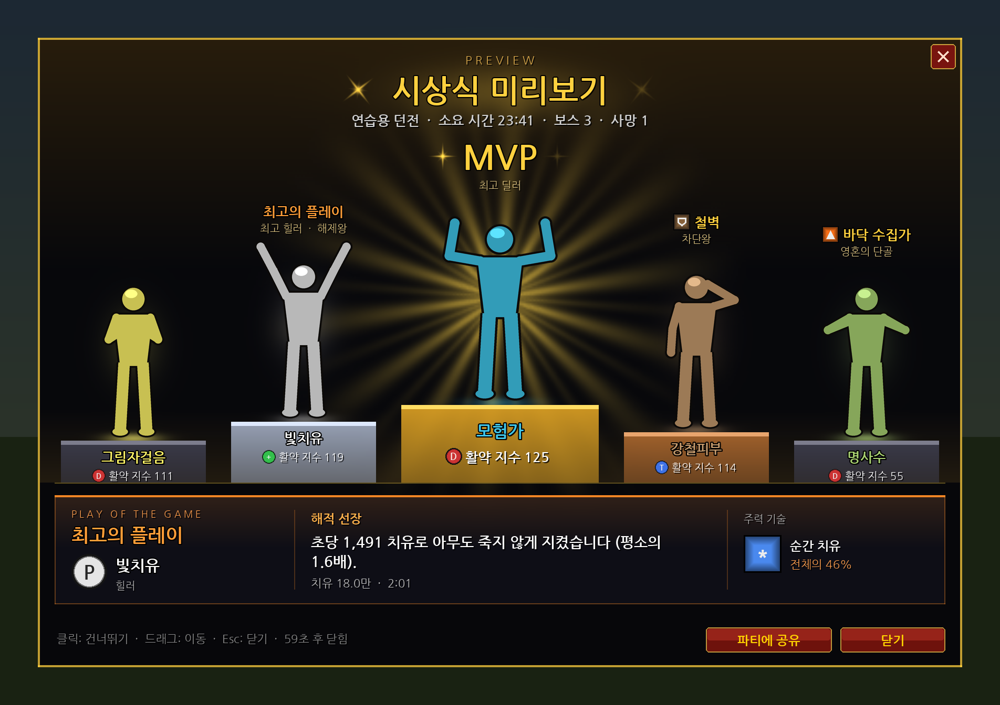

# WoW Forever 애드온

| 애드온 | 하는 일 |
| --- | --- |
| [BIG PODIUM (시상식)](#big-podium-시상식) | 던전을 클리어하면 미터기 기록으로 **MVP · 최고의 플레이(POTG)** 시상식을 보여 줍니다. |
| [Twinkle (반짝이)](#twinkle-반짝이) | 퀘스트 오브젝트, 약초, 광맥을 반짝이게 표시합니다. |

설치는 둘 다 같습니다. 애드온 폴더(`BigPodium`, `Twinkle`)를 통째로 `World of Warcraft\_forever_\Interface\AddOns\` 안에 복사하고, 캐릭터 선택 화면의 **애드온** 목록에서 켜져 있는지 확인하세요. (`BigPodium.toc` 파일이 `AddOns\BigPodium\` 바로 안에 있어야 합니다.)

---

# BIG PODIUM (시상식)

AOS 게임이 끝나면 나오는 MVP / POTG 화면처럼, **던전을 클리어하면 시상식**이 열립니다. 데이터는 게임에 내장된 **미터기 기록**(`C_DamageMeter`)에서 가져옵니다. 포에버의 미터기 애드온 대부분도 이 기록을 보여 줍니다. 따로 미터기 애드온이 없어도 되고, 있어도 상관없습니다.



<sub>`/mvp test` 미리보기 화면을 애드온 코드 그대로 그린 그림입니다 (`tools/render_podium_preview.py`). 단상 위 사람 모양은 자리 표시용이고, **게임 안에서는 파티원 각자의 실제 캐릭터(3D 모델)** 가 그 자리에서 감정표현을 합니다. 직업·역할·기술 아이콘도 게임에서는 실제 아이콘으로 나옵니다.</sub>

## 시상식 화면

**단상(포디움)** 위에 파티원 **각자의 캐릭터**가 올라가서 결과에 맞는 **감정표현**을 합니다. 가운데 가장 높은 금색 단상이 MVP(다른 사람보다 크게 나옵니다), 그 양옆이 2·3등(은·동), 바깥쪽이 4·5등입니다 (활약 지수 순서). 단상 앞에는 이름과 활약 지수, 머리 위에는 받은 상이 표시됩니다.

단상은 금·은·동·강철 **금속 블록**처럼 보이게 그렸습니다: 윗면이 보이는 입체감, 금속 광택과 모서리, 이름이 새겨진 판, 발밑 그림자와 블록 사이 그늘. MVP가 등장하면 위쪽 양 모서리의 **조명**이 대각선으로 MVP를 비추며 천천히 움직이고 **꽃가루**가 떨어집니다 (설정에서 끌 수 있음). 애드온은 단상 같은 3D 물체 모델을 불러와 캐릭터와 정확히 맞춰 세울 수 없어서, 단상은 입체처럼 보이는 그림으로 만들었습니다.

| 받은 상 | 감정표현 |
| --- | --- |
| MVP | 근육 자랑 → 포효 (빛줄기 연출) |
| 최고의 플레이 | 환호 → 춤 |
| 최고 딜러 | 포효 → 환호 |
| 최고 힐러 | 인사 → 환호 |
| 철벽 · 무사고 | 경례 → 포효/환호 |
| 차단왕 | 가리키기 → 환호 |
| 해제왕 | 손 흔들기 → 환호 |
| 바닥 수집가 (재미) | 닭 흉내 |
| 영혼의 단골 (재미) | 울기 |
| 어그로 장인 | 경례 → 포효 |
| 쉴 틈 없는 손 | 환호 → 가리키기 |
| 구사일생 | 인사 → 환호 |
| 레디 번개 | 경례 → 손 흔들기 |
| 득템왕 · 주사위의 신 | 춤 · 환호 |
| 수다왕 | 말하기 |
| 분위기 메이커 | 춤 |
| 탱커 지망생 (재미) | 포효 → 근육 자랑 |
| 헛손질 (재미) | 웃기 |
| 꽝손 (재미) | 울기 |
| 랜선 여행자 (재미) | 손 흔들기 |
| 잠수부 (재미) | 자기 |
| 상 없음 | MVP에게 박수 |

감정표현이 끝나면 잠깐 서 있다가 다시 반복합니다. 캐릭터는 가운데(MVP) 쪽으로 살짝 몸을 돌립니다.

- **멀리 있는 파티원도 캐릭터로 나옵니다.** 게임은 가까이 있는 사람의 모습만 보내 주기 때문에, 애드온이 던전을 도는 동안 파티원이 근처에 올 때마다(전투 밖에서) 그 사람의 캐릭터를 저장해 둡니다. 시상식 때 멀리 있으면 저장해 둔 캐릭터가 단상에 섭니다. 가까이 있으면 그 자리에서 새로 불러옵니다.
- **직업 아이콘**이 나오는 경우: 파티에 들어온 뒤로 한 번도 근처에 온 적이 없는 사람, `/reload` 이후 아직 근처에 오지 않은 사람, 게임이 모델을 보여 주지 못한 경우. 11명 이상 공격대에서는 메모리를 아끼려고 미리 저장하지 않아서, 시상식 때 가까이 있는 사람만 캐릭터로 나옵니다.
- 공격대처럼 6명 이상이면 단상에는 상위 5명이 서고, 나머지 인원 수가 표시됩니다.
- 마우스를 캐릭터에 올리면 받은 상과 세부 기록(피해, 치유, 받은 피해, 차단, 해제, 사망, 점수 계산)이 나옵니다.
- 설정에서 '단상에 각자 캐릭터가 감정표현하며 등장'을 끄면 모두 직업 아이콘으로 나옵니다.
- 캐릭터는 발이 단상 윗면에 닿도록 놓입니다. 게임 안에서 떠 있거나 파묻혀 보이면 설정의 **캐릭터 높낮이**로 맞추고, **캐릭터 크기**(80–120%)로 크기를 바꿀 수 있습니다. 설정 창의 미리보기 버튼으로 바로 확인할 수 있습니다.
- `/mvp test` 미리보기에서는 단상 5자리가 모두 캐릭터로 찹니다. 혼자면 **내 캐릭터 5명**이 각자 다른 감정표현을 하고, 파티 중이면 파티원은 본인 캐릭터로, 남는 자리는 내 캐릭터로 채웁니다.

## 시상식 순서

1. **던전 클리어!** – 제목. 던전 이름, 소요 시간, 잡은 보스 수, 사망·전멸 수, 기록은 창 맨 아래 줄에 나옵니다.
2. **최고의 플레이 (POTG)** – 아래쪽 카드. 한 전투에서 가장 돋보였던 순간 하나입니다. 보스 전투, 특히 마지막 보스일수록 점수가 큽니다.
   - 딜: 그 전투에서 파티 피해의 몇 %를 혼자 했는지 (역할 기대치 대비)
   - 힐: 평소보다 몇 배 빠르게 치유했는지, 그리고 아무도 죽지 않았는지
   - 탱: 평소보다 몇 배 많은 피해를 받아내고 살아남았는지
   - 차단: 한 전투에서 3번 이상 시전 차단
   - 그 사람의 주력 기술과 비중도 함께 보여 줍니다.
3. **단상 입장** – 바깥쪽(5등)부터 한 명씩 등장해 감정표현
4. **MVP** – 마지막으로 가운데 금색 단상에 **활약 지수**가 가장 높은 사람이 등장 (빛줄기 연출)
5. **부문별 시상** – 각자 머리 위에: 최고 딜러, 최고 힐러, 철벽(탱커), 차단왕, 해제왕, 어그로 장인, 쉴 틈 없는 손, 구사일생, 레디 번개 + 재미 부문(바닥 수집가, 영혼의 단골, 탱커 지망생, 헛손질, 득템왕, 주사위의 신, 꽝손, 수다왕, 분위기 메이커, 랜선 여행자, 잠수부) / 무사고. 창 맨 아래 줄에는 전멸 횟수와 이 던전의 **최고 기록**도 나오고, 신기록이면 제목 위에 NEW RECORD가 뜹니다.

클릭하면 연출을 건너뛰고, 드래그로 옮길 수 있고, Esc로 닫힙니다. **파티에 공유** 버튼은 결과 요약을 파티(또는 인스턴스/공격대) 대화로 보냅니다.

## 활약 지수 (MVP 점수)

딜량 1등이 무조건 MVP가 되지 않도록, 각자의 **역할 기준**으로 비교합니다. **100 = 그 역할의 평균적인 활약**입니다.

| 역할 | 기준 |
| --- | --- |
| 딜러 | 파티 전체 피해 중 내 비중 |
| 힐러 | 파티 전체 치유 중 내 비중 (80%) + 피해 비중 (20%) |
| 탱커 | 파티가 받은 피해 중 내 비중 (50%) + 피해 비중 (50%) |

- 역할별 기대치는 보통 파티(탱1 힐1 딜3) 기준으로 탱커 피해 15%, 힐러 피해 3%, 힐러 치유 93%, 탱커 받은 피해 83%입니다. 파티 구성이 다르면 기대치도 자동으로 바뀝니다.
- 차단·해제 1회당 **+2** (최대 +20), 사망 1회당 **-12** (최대 -48), 파티가 받은 '피할 수 있는 피해' 중 내 비중만큼 최대 **-20**
- 미터기 밖의 기록(아래): 탱커가 전투 중 어그로를 잡고 있던 비율이 60%를 넘으면 최대 **+10** (95%에서 +10), 탱커가 아닌데 몹이 달려든 횟수 1번당 **-2** (최대 -10)
- 역할은 파티 찾기 역할을 쓰고, 없으면 기록으로 추측합니다 (치유가 피해보다 많고 파티 치유의 25% 이상 → 힐러, 받은 피해가 압도적 → 탱커).

## 미터기 밖에서 보는 실력과 재미

미터기에는 없지만 게임이 애드온에게 알려 주는 정보로 던전을 도는 동안 함께 기록합니다. 전투 로그는 쓰지 않습니다.

| 항목 | 어떻게 보는지 | 반영 |
| --- | --- | --- |
| 어그로 유지 (탱커) | 전투 중 0.5초마다 파티원이 몹의 공격 대상인지 확인 (`UnitThreatSituation`) | 활약 지수 +최대 10, **어그로 장인** |
| 몹이 달려든 횟수 (탱커 외) | 같은 확인에서 탱커가 아닌 사람이 몹에게 맞기 시작한 횟수 (1초 이상) | 활약 지수 −2씩, 재미 **탱커 지망생** |
| 분당 시전 | 전투 중 시전 성공 횟수 (자동 사격·평타 제외) | **쉴 틈 없는 손** |
| 구사일생 | 전투 중 체력이 10% 이하로 떨어졌다가 살아서 전투를 마친 횟수 | **구사일생** |
| 레디 응답 속도 | 전투 준비 확인에 '준비 완료'를 누르기까지 걸린 시간 | **레디 번개** |
| 시전 끊김 | 시전하다 끊긴 횟수 (움직임·차단) | 재미 **헛손질** |
| 전리품 · 주사위 | 획득 메시지(고급 이상)와 입찰·차비 주사위 결과 | 재미 **득템왕**, **주사위의 신**(90 이상), **꽝손**(10 이하) |
| 채팅 · 감정표현 | 파티(공격대·인스턴스) 대화 수, 감정표현 수 (내용은 저장하지 않음) | 재미 **수다왕**, **분위기 메이커** |
| 접속 끊김 · 자리 비움 | 파티원의 접속 상태, 자리 비움 표시 | 재미 **랜선 여행자**, **잠수부** |
| 전멸 · 기록 | 보스 전투 실패 횟수, 이 던전(난이도별)에서 가장 빠른 클리어 시간 | 창 맨 아래 줄 |

- 게임이 숫자를 '비밀 값'으로 숨기는 경우(예: 전투 중 체력이나 위협 수준을 숨기는 상황)에는 그 항목을 건너뜁니다. 그래서 그 상은 나오지 않을 수 있습니다.
- 분당 시전은 전투 시간이 1분 이상, 어그로 유지는 20초 이상 확인된 사람만 셉니다.
- 전리품·주사위는 게임 안 문구 그대로를 읽기 때문에 한국어·영어 클라이언트 모두 됩니다.
- 기록은 던전 클리어(마지막 보스, 던전 찾기 완료 등)로 끝난 경우만 남깁니다. 중간에 나간 경우는 제외합니다.

## 언제 열리나요?

| 상황 | 판단 방법 |
| --- | --- |
| 마지막 보스 처치 | 모험 안내서의 보스 목록에서 마지막 보스를 잡았거나, 목록의 보스를 모두 잡았을 때 |
| 던전 찾기 / 시나리오 / 쐐기 완료 | 게임의 완료 이벤트 (`LFG_COMPLETION_REWARD` 등) |
| 안내서에 없는 던전 | 보스를 하나 이상 잡고 **던전에서 나갈 때** (유령으로 달려 나간 경우는 제외) |

전투 중에는 열리지 않고, 전투가 끝나고 2초 뒤에 열립니다. 시상식이 떠 있을 때 전투가 시작되면 닫힙니다(설정 가능).

## 알아 둘 점

- **전투 중에는 미터기 숫자가 '비밀 값'** 이라서 애드온이 읽을 수 없습니다. 그래서 전투가 끝날 때마다 그 전투 기록을 애드온 쪽에 복사해 둡니다. 미터기가 오래된 전투를 지우거나 미터기를 초기화해도 이미 복사한 기록은 남습니다.
- 던전에 들어가기 **전**의 전투와, 나온 **뒤**의 전투는 포함하지 않습니다. 죽어서 무덤에서 달려 들어오거나, 던전 안에서 `/reload`·재접속해도 같은 던전 기록으로 이어집니다.
- 내장 미터기를 쓸 수 없는 상태(예: 레벨 제한)면 시상할 기록이 없다고 알려 줍니다. `/mvp debug` 로 애드온이 읽은 미터기 상태를 볼 수 있습니다.
- 최근 기록 5개를 저장해 두고 `/mvp history` 로 다시 볼 수 있습니다.

## 사용법

| 명령 | 설명 |
| --- | --- |
| `/mvp` (또는 `/시상식`, `/bigpodium`) | 지난 시상식 보기 (던전 진행 중이면 지금까지의 기록) |
| `/mvp test` | 가짜 기록으로 미리보기 (혼자면 내 캐릭터 5명, 파티 중이면 파티원 캐릭터 + 빈 자리는 내 캐릭터) |
| `/mvp history`, `/mvp history 2` | 최근 기록 목록 / 2번째 기록 다시 보기 |
| `/mvp share` | 지난 결과를 파티 대화로 공유 |
| `/mvp options` | 설정 창 (`ESC > 설정 > 애드온 > BIG PODIUM`) |
| `/mvp on`, `/mvp off` | 시상식 켜기 / 끄기 (꺼도 기록은 계속 남깁니다) |
| `/mvp debug` | 미터기·던전 기록 상태 출력 |

미니맵 옆 **애드온 목록 버튼**에도 들어 있습니다 (좌클릭: 지난 시상식, 우클릭: 설정).

### 설정 항목

- 시상식 켜기
- 마지막 보스를 모르는 던전은 나갈 때 시상식 (기본 켜짐)
- 공격대에서도 열기 (기본 켜짐)
- 단상에 각자 캐릭터가 감정표현하며 등장 (기본 켜짐, 끄면 직업 아이콘)
- MVP 등장 때 꽃가루 (기본 켜짐)
- 캐릭터 크기 (80–120%), 캐릭터 높낮이 (-40 ~ +40, 떠 있으면 내리고 파묻히면 올림)
- 뒤쪽 화면 어둡게, 효과음, 재미 부문, 전투가 시작되면 닫기
- 자동으로 닫기 (기본 60초, 0 = 안 함, 마우스를 올리면 멈춤), 크기 (60–140%)
- 미리보기 / 지난 시상식 버튼

---

# Twinkle (반짝이)

WoW Forever(와우 포에버)용 애드온입니다. **퀘스트 오브젝트**, **약초**, **광맥**을 반짝이게 표시합니다.


색깔: 퀘스트 = 금색, 약초 = 초록, 광맥 = 하늘색, 보물상자 = 보라, 관심 목록 = 분홍

## 하는 일

| 대상 | 방법 |
| --- | --- |
| 퀘스트 오브젝트 | 클라이언트에 원래 있는 **퀘스트 목표 반짝이/테두리 효과**를 켭니다. 포에버 설정 메뉴에는 숨겨져 있는 기능이고, 켜면 주변의 **모든** 퀘스트 오브젝트에 적용됩니다. |
| 약초 · 광맥 · 보물상자 (앞쪽) | 앞에 있는 오브젝트(상호작용 대상)에 반짝이 애니메이션(빛무리 + 회전하는 별 + 퍼지는 고리 + 작은 반짝임)을 그립니다. |
| 뒤돌았을 때 | 한 번 반짝인 오브젝트는 몸을 돌려도 화면 가장자리의 **그 방향**에 계속 반짝입니다. 뒤에 있으면 캐릭터 아래쪽, 왼쪽에 있으면 왼쪽. 다시 바라보거나, 채집하거나, 멀어지면 사라집니다. |
| 관심 목록 | 이름을 등록한 오브젝트(예: 검은 연꽃)는 분홍색으로 반짝이고 경고음이 납니다. |
| 미니맵 버튼 | 좌클릭 설정, 우클릭 켜기/끄기, 휠 클릭 미리보기, 드래그로 위치 이동. 미니맵 옆 **애드온 목록 버튼**에도 들어 있습니다. |

### 오브젝트 종류를 구분하는 방법

언어와 상관없이 동작하도록 다음 순서로 판단합니다.

1. 게임이 그 오브젝트에 보여 줄 **커서 아이콘** (약초 채집 / 채광 / 퀘스트 / 줍기)
2. 오브젝트 ID 표 (클래식 약초 47종, 광맥 39종)
3. 직접 채집하면서 **학습한 이름** (약초 채집·채광 시전 대상)
4. 완료하지 않은 **퀘스트 목표 문구에 들어 있는 이름**

## 알아 둘 점

- WoW 애드온은 3D 오브젝트에 직접 효과를 그릴 수 없습니다. 그래서 약초·광맥 반짝이는 게임이 상호작용 대상에게 붙여 주는 이름표 위에 그리고, **한 번에 하나**(화면에 보이는 가장 가까운 오브젝트)만 표시됩니다.
- **한 번도 화면에 들어오지 않은 오브젝트는 찾을 수 없습니다.** 게임은 화면 밖 오브젝트를 상호작용 대상으로 고르지 않고, 다른 오브젝트의 위치는 애드온에게 숨깁니다 (위치를 알려 주는 API는 있지만 값이 항상 '비밀 값'으로 와서 쓸 수 없습니다).
- 뒤돌았을 때 표시하는 방향은 오브젝트를 봤을 때의 **캐릭터 방향과 화면 속 위치**로 계산합니다. 두 곳 이상에서 보면 위치를 계산해서 거리도 표시합니다. 한 곳에서만 봤다면 10미터 넘게 움직이면 잊어버립니다. 화면 가장자리에는 최대 3개, 기억은 최근 8개까지입니다.
- 더 멀리 있는 약초·광맥은 미니맵 추적(약초 찾기 / 광물 찾기)과 함께 쓰세요.
- 앞에 있는 오브젝트를 애드온이 알 수 있는 방법은 게임의 **상호작용 대상 지정** 기능뿐이라, 이 기능은 내부적으로 켜 둡니다. 포에버에서 약초·광맥을 반짝이게 하는 다른 애드온(NodeSight Sparkles, Lueur 등)도 같은 방식이고, 퀘스트 아이템 반짝이만 상호작용 없이 됩니다.
- 부작용을 줄이려고: 상호작용 단축키는 지정하지 않아도 되고, NPC·의자 위 상호작용 아이콘과 "상호작용 키" 안내 창은 뜨지 않으며, 상호작용 이름표는 반짝일 오브젝트를 바라볼 때만 켜집니다. **전투 중에는 원래 설정으로 돌아갑니다.**
- 알려진 부작용: 전투 밖에서 대상 없이 아군 주문을 쓰면, 근처 아군 플레이어가 상호작용 대상이었을 때 그쪽으로 시전될 수 있습니다 (이 방식을 쓰는 애드온 공통).
- 정말로 끄고 싶다면 설정에서 '앞에 있는 오브젝트 반짝이기'를 끄면 됩니다. 약초·광맥 반짝이도 같이 꺼지고, 퀘스트 오브젝트 효과만 남습니다.
- 퀘스트 오브젝트의 '테두리' 방식은 그래픽 설정의 **테두리 모드**가 꺼져 있으면 보이지 않습니다. 그럴 땐 '반짝이' 방식을 쓰세요.
- 애드온이 바꾼 게임 설정(CVar)은 계정에 저장됩니다. **애드온을 지우기 전에 `/tw off`** 를 입력하면 원래 값으로 되돌립니다.

## 설치

1. `Twinkle` 폴더를 통째로 다음 위치에 복사합니다.
   `World of Warcraft\_forever_\Interface\AddOns\Twinkle`
   (`Twinkle.toc` 파일이 `AddOns\Twinkle\` 바로 안에 있어야 합니다.)
2. 게임 접속 후 캐릭터 선택 화면의 **애드온** 목록에서 Twinkle이 켜져 있는지 확인합니다.

## 사용법

`/tw` (또는 `/반짝`, `/twinkle`) 로 설정 창을 엽니다. 설정은 `ESC > 설정 > 애드온 > Twinkle (반짝이)` 에도 있습니다.

| 명령 | 설명 |
| --- | --- |
| `/tw` | 설정 열기 |
| `/tw on`, `/tw off` | 켜기 / 끄기 (끄면 게임 설정 원래대로) |
| `/tw test` | 반짝이 미리보기 (6초) |
| `/tw minimap` | 미니맵 버튼 보이기 / 숨기기 |
| `/tw watch add 검은 연꽃` | 관심 목록에 추가 (항상 반짝이 + 경고음) |
| `/tw watch del 검은 연꽃`, `/tw watch list` | 관심 목록 삭제 / 보기 |
| `/tw learned`, `/tw learned clear` | 채집하며 배운 오브젝트 보기 / 지우기 |
| `/tw debug` | 지금 바라보는 오브젝트를 애드온이 어떻게 판단했는지 출력 |
| `/tw debug on` | 새 오브젝트를 찾을 때마다 판단 근거를 채팅창에 출력 |

### 설정 항목

- **퀘스트 오브젝트 강조 방식**: 반짝이 / 테두리 / 변경 안 함
- **테두리 적용 대상**: 퀘스트 오브젝트만 / + 마우스 올린 대상 / + 선택한 대상
- **종류별 반짝이 켜기/끄기**: 퀘스트 오브젝트, 약초, 광맥, 보물상자, 관심 목록, 기타 오브젝트(기본 꺼짐)
- **탐지 거리** (5–45미터, 기본 20), **탐지 방향** (정면만 / 앞쪽 / 화면에 보이는 곳 전체)
- **뒤돌아도 반짝이 유지** (기본 켜짐)
- **반짝이 크기** (기본 40), **세로 위치** (기본 -30), 종류 이름 표시
- 이름표가 없을 때 화면 알림, 새 오브젝트 발견 시 소리, NPC 위 상호작용 아이콘 (기본 꺼짐)
- **미니맵 버튼 표시**

## 문제가 있을 때

어떤 오브젝트가 반짝이지 않거나 다른 색으로 반짝이면, 그 오브젝트를 바라본 상태에서 `/tw debug` 를 입력하고 출력 내용을 알려 주세요. 커서 아이콘 ID, 오브젝트 ID가 나오므로 판별 표에 추가할 수 있습니다.

---

# 개발

```
BigPodium/          시상식 애드온 (이 폴더만 배포)
  BigPodium.toc
  Locale.lua        한국어 / 영어 문자열, 숫자 표기 (만/억)
  Meter.lua         내장 미터기(C_DamageMeter) 읽기
  Awards.lua        활약 지수, 최고의 플레이, 부문별 시상, 미리보기 데이터
  Core.lua          던전 기록, 마지막 보스 판정, 이벤트
  Models.lua        파티원 캐릭터 저장 (멀리 있어도 단상에 세우기 위해)
  Tracker.lua       미터기 밖의 기록 (어그로, 시전, 체력, 전리품, 채팅, 레디, 접속)
  Ceremony.lua      시상식 창, 단상 위 캐릭터와 감정표현, 연출
  Options.lua       설정 창, 슬래시 명령, 애드온 목록 버튼
  Media/*.tga       빛줄기·빛무리·별·고리·아이콘 (tools/make_podium_media.py 로 생성)
Twinkle/            반짝이 애드온 (이 폴더만 배포)
  Twinkle.toc
  Locale.lua        한국어 / 영어 문자열
  Data.lua          커서 아이콘 ID, 약초·광맥 오브젝트 ID, 색상
  Sparkle.lua       반짝이 애니메이션
  Core.lua          CVar 관리, 오브젝트 판별, 이벤트
  Memory.lua        뒤돌았을 때 화면 가장자리 반짝이
  MinimapButton.lua 미니맵 버튼, 애드온 목록 메뉴
  Options.lua       설정 창, 슬래시 명령
  Media/*.tga       반짝이 텍스처 (tools/make_textures.py 로 생성)
tests/              WoW API 모의 환경 + 동작 테스트 (두 애드온)
tools/              텍스처 / 미리보기 생성 스크립트
```

테스트 (Lua 5.1 런타임으로 실제 애드온 코드를 모의 WoW API 위에서 실행):

```bash
pip install lupa
```

```bash
python3 tests/run_tests.py
```

애드온 하나만: `python3 tests/run_tests.py BigPodium`

텍스처 다시 만들기:

```bash
python3 tools/make_podium_media.py
```

```bash
python3 tools/make_textures.py --preview
```

시상식 화면 그림 다시 만들기 (한글 글꼴 `fonts-nanum` 필요):

```bash
python3 tools/render_podium_preview.py
```
